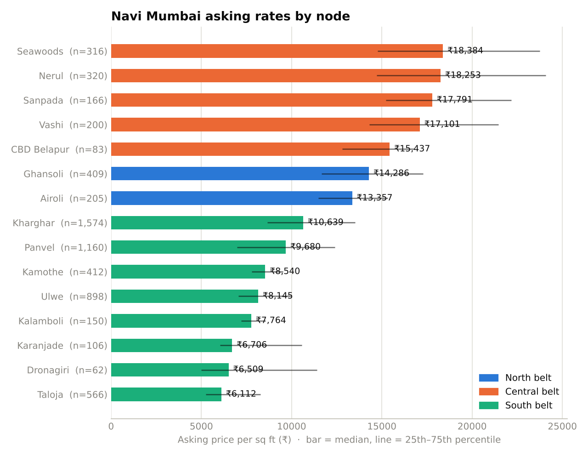

# Navi Mumbai Residential Pricing, 2024

Pricing analysis for flats across 18 Navi Mumbai nodes, built on 2024 Makaan.com listings: a cleaning pipeline, regression models that value a flat from its location and attributes, an interactive benchmark dashboard, and a written market report.



## What's in it

| Part | File | What it does |
|---|---|---|
| Cleaning pipeline | `src/clean.py` | Filters 2024 MMR listings to Navi Mumbai, maps free-text localities to 18 canonical nodes, keeps apartments, filters implausible sizes, trims per-node outliers, and removes repeat listings of the same flat. 10,792 Navi Mumbai rows → 6,680 unique listings. |
| Valuation models | `src/model.py` | Hedonic log-linear regression and gradient boosting, compared against a per-sq-ft rule of thumb with project-grouped 5-fold CV. Also estimates location premiums with robust standard errors and runs a fair-value screen. |
| Dashboard | `dashboard/index.html` | Self-contained page (no server). Filter by belt and BHK to recompute node benchmarks, ticket sizes and newer-vs-older building rates; includes an in-browser valuation estimate. |
| Market report | `docs/market_report.md` | Findings on node benchmarks, location premiums, ticket sizes, building age and model accuracy. |

## Key results

- **Three-tier market:** median asking rate ₹17,500/sq ft in the Central belt (Vashi–Belapur), ₹13,800 in the North (Airoli, Ghansoli), ₹8,900 in the South growth belt (Kharghar–Panvel–Taloja).
- **Location premium:** an identical flat lists for +71% in Seawoods and −40% in Taloja compared with Kharghar.
- **Model accuracy:** gradient boosting reaches R² 0.818 on log price and a 16.4% median error, against 21.2% for node median rate × area.
- **Building age:** newer buildings ask about the same per sq ft as older ones in most nodes; Panvel (+18%) is the exception.

| Model (out-of-fold, grouped by project) | R² log price | Median error | Within 20% |
|---|---|---|---|
| Node median rate × area | 0.691 | 21.2% | 47.6% |
| Hedonic regression | 0.774 | 19.4% | 51.5% |
| Gradient boosting | 0.818 | 16.4% | 57.8% |

## Run it

```bash
pip install -r requirements.txt
python run_pipeline.py
```

This rebuilds `data/processed/listings.csv`, everything in `outputs/`, the report figures in `docs/figures/`, and `dashboard/index.html`. Open the dashboard file directly in a browser.

## Methodology notes

- **Grouped cross-validation.** The same building is often listed many times. Folds are split by project so the model is always tested on buildings it has not seen; random splits overstate accuracy.
- **Log price target.** Prices are right-skewed and errors scale with price, so models predict log price and report percentage errors.
- **Robust inference.** Location premiums come from OLS with HC3 heteroskedasticity-robust standard errors.
- **Deduplication.** Listings match on node, BHK, area and price rounded to ₹10,000.

## Limitations

- Asking prices, not registered sale values.
- Listed area may be carpet, built-up or super built-up depending on the listing.
- No unit floor level, possession status, amenities, sale dates, absorption or lead data.
- Listings have no posting date, so the analysis is a single 2024 snapshot.

## Project structure

```
├── data/
│   ├── raw/                 # 2024 Makaan listings (see data/SOURCES.md)
│   └── processed/           # listings.csv, written by the pipeline
├── src/
│   ├── clean.py             # cleaning and deduplication
│   ├── model.py             # valuation, location premiums, fair-value screen
│   └── report.py            # figures and dashboard build
├── dashboard/
│   ├── template.html        # dashboard source
│   └── index.html           # built dashboard with data embedded
├── docs/
│   ├── market_report.md
│   └── figures/
├── outputs/                 # metrics, premiums, fair-value screen, coefficients
└── run_pipeline.py
```

Data sources and licences: [`data/SOURCES.md`](data/SOURCES.md).
