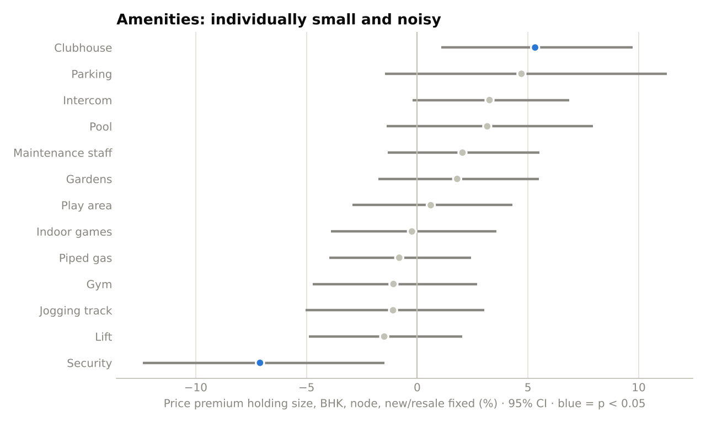

# Navi Mumbai Residential Pricing: Market and Competitor Analysis

**Scope:** 12,531 unique flat listings across 18 Navi Mumbai nodes, combined from three public listing datasets (see `data/SOURCES.md`).
**Price basis:** asking prices on property portals, per sq ft of listed area (often built-up rather than RERA carpet area).
**Period:** listings scraped between roughly 2023 and 2024. Absolute rates will have moved since; the relative structure between nodes changes much more slowly.

---

## 1. Summary

1. **Navi Mumbai is three markets, not one.** The established Central belt (Vashi to CBD Belapur) asks a median **₹16,800/sq ft**, the North belt (Airoli, Ghansoli) **₹13,200**, and the South growth belt (Kharghar to Panvel and Taloja) **₹8,400**.
2. **Location dominates price.** After holding size, BHK, bathrooms, age and furnishing constant, the same flat lists for **+71% in Seawoods** and **−40% in Taloja** compared with Kharghar.
3. **Kharghar is the volume market.** It accounts for 24% of listings, with a median ticket of **₹1.24 Cr** (2 BHK: ₹1.10 Cr). It is the natural reference point for pricing any South-belt project.
4. **New supply is concentrated in the Panvel–Taloja–Dronagiri corridor**, where 50–59% of listings are under construction and new launches ask 13–18% more per sq ft than ready stock in Panvel and Taloja.
5. **Amenities add little on their own.** Each additional amenity in a project's package is worth about **+0.8%** on price (95% CI 0.5–1.1%), so a full 13-amenity package is worth roughly 10%. Individual amenity effects are too entangled to price separately.
6. **A data-driven valuation beats the per-sq-ft rule of thumb** (median error 16.0% vs 20.8%), but asking-price noise caps achievable accuracy.

---

## 2. Rate benchmarks by node

| Belt | Nodes | Median ₹/sq ft | Share of listings |
|---|---|---|---|
| Central | Seawoods, Nerul, Vashi, Sanpada, Juinagar, CBD Belapur | 16,800 | 15% |
| North | Ghansoli, Airoli, Kopar Khairane, Rabale | 13,200 | 9% |
| South | Kharghar, Panvel, Kamothe, Ulwe, Kalamboli, Karanjade, Taloja, Dronagiri | 8,400 | 76% |

Within the Central belt, Seawoods (₹17,600), Nerul (₹17,400) and Vashi (₹17,000) sit at the top and trade close to one another. Within the South belt there is a clear ladder: **Kharghar (₹10,200) → Panvel (₹8,600) → Kamothe (₹8,200) → Ulwe (₹7,900) → Kalamboli (₹7,700) → Karanjade (₹6,500) → Taloja (₹6,000) → Dronagiri (₹5,700)**. Rabale's low median (₹5,600, 27 listings) reflects a thin, older stock and should not be read as a North-belt benchmark.

The middle half of listings spans roughly ±25% around each node's median, so a single node median is a starting point for pricing a project, not an answer.

---

## 3. What location alone is worth

Raw node medians mix location with differences in flat size and age. A hedonic regression of log price on area, BHK, bathrooms, building age, furnishing and node isolates the location effect:

| Node | Premium vs identical flat in Kharghar | 95% CI |
|---|---|---|
| Seawoods | +71% | +65% to +77% |
| Sanpada | +68% | +60% to +76% |
| Nerul | +64% | +57% to +72% |
| Vashi | +59% | +52% to +68% |
| CBD Belapur | +39% | +31% to +49% |
| Ghansoli | +38% | +34% to +43% |
| Airoli | +31% | +25% to +36% |
| Kamothe | −13% | −15% to −11% |
| Ulwe | −15% | −17% to −13% |
| Panvel | −19% | −21% to −17% |
| Kalamboli | −22% | −24% to −19% |
| Karanjade | −31% | −34% to −28% |
| Dronagiri | −34% | −39% to −29% |
| Taloja | −40% | −41% to −38% |

The Ghansoli (+38%) and Airoli (+31%) premiums are larger than their raw per-sq-ft gaps to Kharghar (+35% and +25%) once size and configuration are held fixed. Both nodes sit on the Thane–Belapur employment corridor.

---

## 4. Ticket sizes and configuration mix

2 BHK units make up 46% of listings and 1 BHK units 31%; 3 BHK is 20% and larger units under 4%. Median asking prices by configuration in the main nodes:

| Node | 1 BHK | 2 BHK | 3 BHK |
|---|---|---|---|
| Seawoods | ₹78 L | ₹1.90 Cr | ₹3.25 Cr |
| Vashi | ₹85 L | ₹1.95 Cr | ₹2.85 Cr |
| Ghansoli | ₹80 L | ₹1.60 Cr | ₹2.45 Cr |
| Kharghar | ₹55 L | ₹1.10 Cr | ₹1.72 Cr |
| Panvel | ₹46 L | ₹81 L | ₹1.35 Cr |
| Ulwe | ₹48 L | ₹90 L | ₹1.50 Cr |
| Taloja | ₹35 L | ₹57 L | ₹74 L |

The 2 BHK step-up from Kharghar (₹1.10 Cr) to the main Central nodes (Seawoods, Nerul, Vashi, Sanpada: ₹1.75–1.95 Cr) is roughly ₹65–85 lakh, which is the core trade-off a buyer weighs between the two belts. The full table, filterable by belt, is in the dashboard.

---

## 5. Supply pipeline: ready vs under construction

| Node | Under-construction share | UC rate vs ready rate |
|---|---|---|
| Taloja | 59% | +13% |
| Dronagiri | 57% | +3% |
| Panvel | 50% | +18% |
| Kalamboli | 29% | +7% |
| Kharghar | 24% | −1% |
| Ulwe | 16% | −3% |
| Airoli | 14% | −1% |
| Kamothe | 4% | +2% |

Shares are from the one source that records possession status (4,753 listings). Vashi (60% under construction, +15%) and Seawoods (+64%) also show large new-launch premiums, but each rests on 40–50 under-construction listings, so the gap mostly reflects which new projects happen to be listed rather than a like-for-like comparison.

Two readings for launch pricing:

- **In Panvel and Taloja, new launches already command a premium** over ready stock. A project there competes mainly with other launches, and buyers are paying up for new product.
- **In Kharghar and Ulwe, new launches price at par with or below ready flats.** A launch there has to compete directly with resale inventory, which limits how far above the node median it can price.

---

## 6. Amenities

On 1,172 listings with amenity data, only a clubhouse shows a clearly positive individual effect (+5%, 95% CI +1% to +10%). Most others have confidence intervals spanning zero, and 24x7 security even comes out negative. This happens because amenities come bundled: projects with a pool almost always have a gym and a clubhouse too, so the regression cannot separate them.

Treating the package as a whole is more reliable: **each additional amenity adds about 0.8%**. For competitor comparison, the useful question is how complete a project's amenity package is relative to others in the same node, not whether it has any one feature.

---

## 7. Valuation model

Three approaches were compared with 5-fold cross-validation on 6,606 listings, with folds split by project so that no building appears in both training and test data:

| Model | R² (log price) | Median error | Within 10% | Within 20% |
|---|---|---|---|---|
| Node median rate × area | 0.711 | 20.8% | 26.3% | 48.3% |
| Hedonic regression | 0.783 | 18.9% | 27.1% | 52.1% |
| Gradient boosting | **0.826** | **16.0%** | **33.2%** | **58.4%** |

Gradient boosting improves on the broker's rule of thumb by about 5 points of median error, partly by using listing coordinates to separate sectors within the same node. The remaining error largely reflects the data: asking prices are negotiable, listed area mixes carpet and built-up measures, and the data has no floor level or view.

**Fair-value screen.** Comparing each asking price with its out-of-fold model value flags 20% of listings as priced more than 25% above comparables and 13% as more than 25% below. These are candidates for a closer look (data errors, distressed sales, premium towers), not verdicts.

---

## 8. Limitations

- Asking prices, not registered transaction values. Actual sale prices in Navi Mumbai typically close below asking.
- Listed area basis varies by listing (carpet, built-up or super built-up), which adds noise to every per-sq-ft figure.
- No unit floor level, sale dates, absorption rates or lead data are available in public listings, so this report covers pricing and supply mix only.
- The three sources overlap in time but are not a single snapshot. Rates should be refreshed with current listings before being used for live pricing.

*Reproduce every number in this report with `python run_pipeline.py`. Outputs are written to `outputs/`.*
