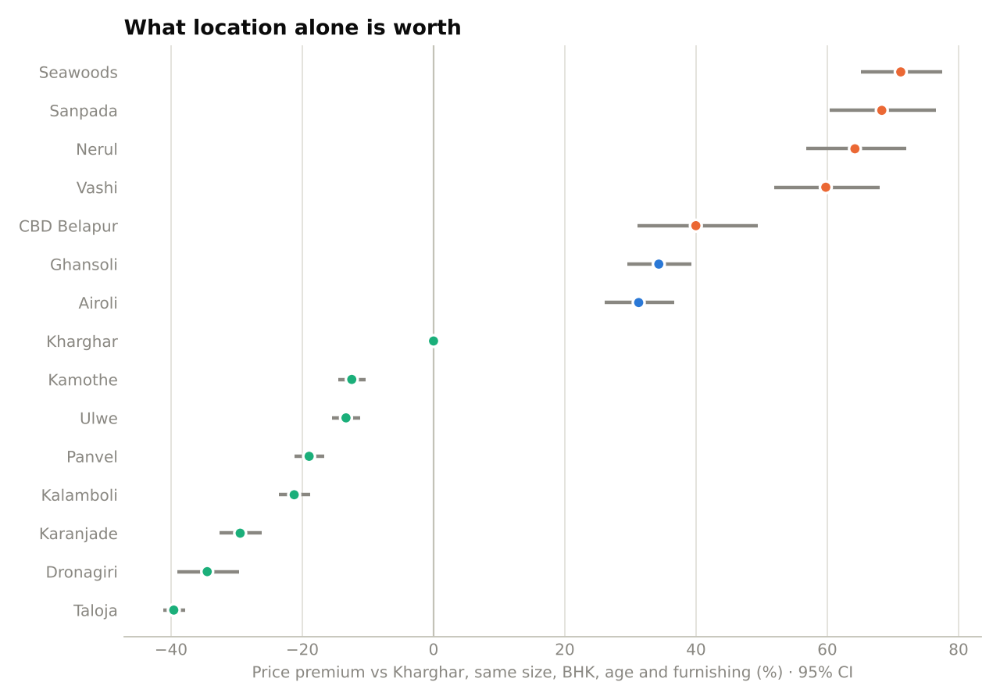
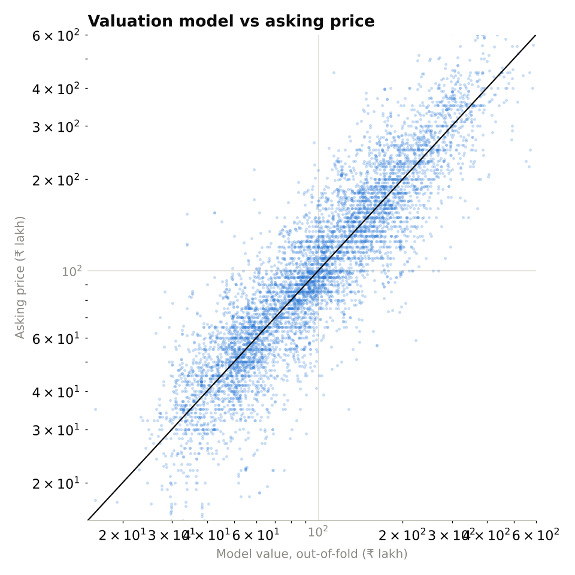

# Navi Mumbai Residential Pricing, 2024

**Scope:** 6,680 unique flat listings across 18 Navi Mumbai nodes from Makaan.com, scraped during 2024 (see `data/SOURCES.md`).
**Price basis:** asking prices, per sq ft of listed area (often built-up rather than RERA carpet area).
**Period:** calendar 2024. Listings carry no posting date, so this is a single 2024 snapshot rather than a month-by-month series.

---

## 1. Summary

1. **Navi Mumbai is three markets, not one.** The established Central belt (Vashi to CBD Belapur) asks a median **₹17,500/sq ft**, the North belt (Airoli, Ghansoli) **₹13,800**, and the South growth belt (Kharghar to Panvel and Taloja) **₹8,900**.
2. **Location dominates price.** After holding size, BHK, bathrooms, age and furnishing constant, the same flat lists for **+71% in Seawoods** and **−40% in Taloja** compared with Kharghar.
3. **Kharghar is the volume market.** It accounts for 24% of listings, with a median ticket of **₹1.25 Cr** (2 BHK: ₹1.12 Cr). It is the natural reference point for pricing any South-belt project.
4. **Building age barely moves asking rates.** Within most nodes, flats in buildings up to 2 years old ask about the same per sq ft as those 8+ years old. Panvel is the clear exception, where newer stock asks 18% more.
5. **A data-driven valuation beats the per-sq-ft rule of thumb** (median error 16.4% vs 21.2%), but asking-price noise caps achievable accuracy.

---

## 2. Rate benchmarks by node

| Belt | Nodes | Median ₹/sq ft | Share of listings |
|---|---|---|---|
| Central | Seawoods, Nerul, Sanpada, Vashi, CBD Belapur, Juinagar | 17,500 | 17% |
| North | Ghansoli, Airoli, Kopar Khairane, Rabale | 13,800 | 10% |
| South | Kharghar, Panvel, Kamothe, Ulwe, Kalamboli, Karanjade, Dronagiri, Taloja | 8,900 | 74% |

Within the Central belt, Seawoods (₹18,400), Nerul (₹18,300), Sanpada (₹17,800) and Vashi (₹17,100) sit at the top and trade close to one another. Within the South belt there is a clear ladder: **Kharghar (₹10,600) → Panvel (₹9,700) → Kamothe (₹8,500) → Ulwe (₹8,100) → Kalamboli (₹7,800) → Karanjade (₹6,700) → Dronagiri (₹6,500) → Taloja (₹6,100)**. Rabale (20 listings) and Kopar Khairane (7 listings) are too thin to benchmark.

The middle half of listings spans roughly ±25% around each node's median, so a node median is a starting point for pricing a project, not an answer.

---

## 3. What location alone is worth

Raw node medians mix location with differences in flat size and age. A hedonic regression of log price on area, BHK, bathrooms, building age, furnishing and node isolates the location effect:

| Node | Premium vs identical flat in Kharghar | 95% CI |
|---|---|---|
| Seawoods | +71% | +65% to +78% |
| Sanpada | +68% | +60% to +77% |
| Nerul | +64% | +57% to +72% |
| Vashi | +60% | +52% to +68% |
| CBD Belapur | +40% | +31% to +49% |
| Juinagar | +36% | +27% to +47% |
| Ghansoli | +34% | +30% to +39% |
| Airoli | +31% | +26% to +37% |
| Kamothe | −13% | −15% to −10% |
| Ulwe | −13% | −15% to −11% |
| Panvel | −19% | −21% to −17% |
| Kalamboli | −21% | −24% to −19% |
| Karanjade | −30% | −33% to −26% |
| Dronagiri | −35% | −39% to −30% |
| Taloja | −40% | −41% to −38% |

Ghansoli and Airoli, on the Thane–Belapur employment corridor, carry a 31–34% premium over Kharghar for the same flat, even though Kharghar is the larger and better-known market.

---

## 4. Ticket sizes and configuration mix

2 BHK units make up 46% of listings and 1 BHK units 31%; 3 BHK is 20% and larger units under 4%. 72% of listings are unfurnished. Median asking prices by configuration in the main nodes:

| Node | 1 BHK | 2 BHK | 3 BHK |
|---|---|---|---|
| Seawoods | ₹82 L | ₹2.00 Cr | ₹3.40 Cr |
| Vashi | ₹82 L | ₹1.98 Cr | ₹2.90 Cr |
| Ghansoli | ₹75 L | ₹1.65 Cr | ₹2.50 Cr |
| Kharghar | ₹56 L | ₹1.12 Cr | ₹1.75 Cr |
| Panvel | ₹47 L | ₹82 L | ₹1.38 Cr |
| Ulwe | ₹50 L | ₹95 L | ₹1.70 Cr |
| Taloja | ₹35 L | ₹55 L | ₹81 L |

The 2 BHK step-up from Kharghar (₹1.12 Cr) to the main Central nodes (Seawoods, Nerul, Vashi, Sanpada: ₹1.77–2.00 Cr) is roughly ₹65–90 lakh, which is the core trade-off a buyer weighs between the two belts. The full table, filterable by belt, is in the dashboard.

---

## 5. Newer vs older buildings

| Node | 0–2 yrs ₹/sq ft | 8+ yrs ₹/sq ft | Newer vs older |
|---|---|---|---|
| Panvel | 10,000 | 8,500 | +18% |
| Ghansoli | 14,500 | 13,300 | +9% |
| Kharghar | 10,800 | 10,300 | +5% |
| Taloja | 6,100 | 6,000 | +3% |
| Airoli | 13,300 | 13,300 | 0% |
| Kamothe | 8,500 | 8,500 | −1% |
| Seawoods | 17,900 | 18,200 | −2% |
| Ulwe | 7,800 | 8,500 | −8% |
| Nerul | 17,900 | 19,400 | −8% |

Main nodes with at least 10 listings in each age band. CBD Belapur and Sanpada are left out: their older-building samples are small (14 and 53 listings) and their medians swing widely between age bands.

Two readings for launch pricing:

- **In Panvel, newer stock commands a clear premium**, possibly reflecting new projects pricing in the upcoming airport ahead of the existing node. A launch there competes mainly with other new projects.
- **In Kharghar, Ulwe, Kamothe and the Central nodes, new and older stock ask about the same.** A launch there competes directly with resale inventory, which limits how far above the node median it can price.

Treat the age field with some caution: 71% of listings report a building age of 0–2 years. This includes new launches but probably also listings where the age was never filled in.

---

## 6. Valuation model

Three approaches were compared with 5-fold cross-validation on 6,680 listings from 1,492 projects, with folds split by project so that no building appears in both training and test data:

| Model | R² (log price) | Median error | Within 10% | Within 20% |
|---|---|---|---|---|
| Node median rate × area | 0.691 | 21.2% | 25.4% | 47.6% |
| Hedonic regression | 0.774 | 19.4% | 26.3% | 51.5% |
| Gradient boosting | **0.818** | **16.4%** | **32.8%** | **57.8%** |

Gradient boosting improves on the broker's rule of thumb by about 5 points of median error, partly by using listing coordinates to separate sectors within the same node. The remaining error largely reflects the data: asking prices are negotiable, listed area mixes carpet and built-up measures, and the data has no floor level or view.

**Fair-value screen.** Comparing each asking price with its out-of-fold model value flags 20% of listings as priced more than 25% above comparables and 13% as more than 25% below. These are candidates for a closer look (data errors, distressed sales, premium towers), not verdicts.

---

## 7. Limitations

- Asking prices, not registered transaction values. Actual sale prices in Navi Mumbai typically close below asking.
- Listed area basis varies by listing (carpet, built-up or super built-up), which adds noise to every per-sq-ft figure.
- No posting dates, so no month-by-month trend within 2024.
- No unit floor level, possession status, amenities, sale dates, absorption rates or lead data, so this report covers pricing only.

*Reproduce every number in this report with `python run_pipeline.py`. Outputs are written to `outputs/`.*
